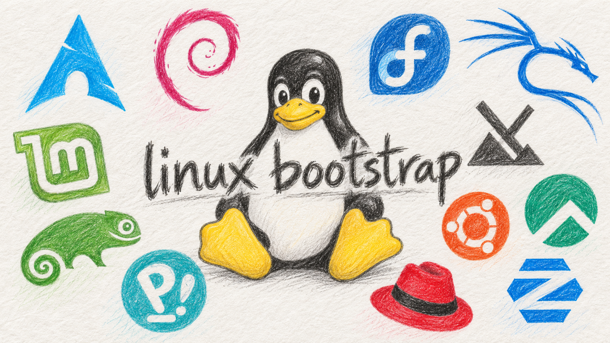

# linux-bootstrap

Scripts de instalação para **LMDE 7 Gigi, baseado no Debian 13 Trixie**, organizados em ferramentas de desenvolvimento e de uso geral. São receitas individuais: a numeração organiza os arquivos e não representa uma instalação automática de todos os aplicativos.

O conjunto foi revisado e testado com simulações no Windows. A instalação real no LMDE, as permissões Linux, as interfaces gráficas e os atualizadores ainda precisam de validação. Outras distribuições exigem análise e adaptações; não há compatibilidade universal declarada.

## 1. Conferir o computador antes de começar

Use o terminal **Bash do Linux instalado** e sua conta normal, com permissão para usar `sudo`. Não execute estes instaladores no PowerShell, no Git Bash do Windows nem como `sudo bash`. O próprio script pede autorização administrativa quando necessário.

Confira:

```bash
cat /etc/os-release
cat /etc/debian_version
dpkg --print-architecture
bash --version
python3 --version
command -v sudo
```

O sistema deve corresponder a LMDE 7/Debian 13, base Trixie, e arquitetura `amd64` ou `arm64`, conforme a receita. O alvo inicial é amd64. Google Chrome, fnm, Blanc e Discord têm limitações específicas de arquitetura; consulte os guias. Python 3 é necessário em várias receitas e deve estar disponível antes das receitas de aplicativos nativos e linguagens via Mise; se estiver ausente, prepare o pacote Debian `python3` antes de continuar. Python do sistema é independente do Python adicional instalado por Mise/pyenv.

Você também precisa de acesso à internet para os repositórios e downloads HTTPS, espaço livre e uma sessão gráfica para os testes dos aplicativos. Antes de atualizar bancos ou reinstalar ferramentas, preserve seus dados importantes. As cópias de retorno dos scripts não substituem backup dos dados pessoais.

## 2. Preservar a estrutura de arquivos

Na cópia do repositório, mantenha esta organização:

```text
linux-bootstrap/
├── README.md
├── .gitignore
├── .gitattributes
└── lmde/
    └── scripts/
        ├── README.md
        ├── APLICATIVOS-NATIVOS.md
        ├── dev-tools/
        │   ├── README.md
        │   ├── MISE.md
        │   └── scripts de desenvolvimento
        ├── user-tools/
        │   ├── README.md
        │   ├── YTDLP.md
        │   └── scripts de uso geral
        └── lib/
            ├── common.sh
            ├── apps.sh
            ├── languages.sh
            ├── services.sh
            ├── flatpak.sh
            ├── ytdlp.sh
            ├── desktop.sh
            └── desktop.py
```

Não copie apenas um instalador. A maioria carrega funções da pasta irmã `lib`; os cinco aplicativos nativos também precisam de `desktop.py`. Bibliotecas são auxiliares, não instaladores independentes. A receita Mise é independente, mas o conjunto deve ser conservado completo para uso e manutenção.

Se usar o ZIP conjunto gerado localmente, ele começa diretamente em `scripts/`. Nesse caso, entre nessa pasta em vez de `lmde/scripts` nos comandos abaixo.

## 3. Escolher e executar uma receita

1. Abra um terminal na pasta `linux-bootstrap` e entre na pasta dos instaladores:

   ```bash
   cd lmde/scripts
   ```

2. Leia o guia da categoria e a ajuda da receita. Exemplo com Git:

   ```bash
   bash "dev-tools/01 - Git.sh" --help
   ```

3. Faça o diagnóstico local:

   ```bash
   bash "dev-tools/01 - Git.sh" --check
   echo $?
   ```

   `echo $?` deve ser executado imediatamente após o comando que você quer conferir. Zero indica que aquele comando terminou sem erro; não comprova instalação ou funcionamento completo de uma interface gráfica. Algumas recusas de confirmação também encerram com zero: leia o resumo e confirme com `--check`. Um código diferente de zero exige ler a mensagem. Se a ferramenta ainda não existe, o diagnóstico pode falhar justamente por isso; não significa que ela foi instalada ou que o script está quebrado. `--check` não baixa nem instala pacotes; alguns diagnósticos de serviços podem pedir `sudo` para consultas locais.

4. Atendidas as condições indicadas no guia, instale a ferramenta escolhida:

   ```bash
   bash "dev-tools/01 - Git.sh"
   echo $?
   ```

   Leia cada etapa, a versão concreta e as confirmações. Execute uma receita por vez. No início, use o modo interativo; `--yes` aceita transações e não deve substituir a leitura do impacto. Nem toda receita tem exatamente a mesma interface; consulte o guia antes de passar opções.

5. Confira novamente e faça o teste funcional recomendado:

   ```bash
   bash "dev-tools/01 - Git.sh" --check
   echo $?
   git --version
   ```

   Para gerenciadores de linguagens, abra um novo terminal. Para aplicativos gráficos, abra pelo menu, teste login e atualização sem `sudo`. Para serviços, confira os testes específicos. Se uma etapa falhar, interrompa a sequência e preserve a mensagem e o caminho da cópia de retorno.

## 4. Escolher as linguagens

Por linguagem, escolha **uma alternativa**. Arquivos `.1` e `.2` não são etapas obrigatórias em sequência.

| Linguagem | Usando Mise já instalado | Instalando o gerenciador tradicional quando necessário |
|---|---|---|
| Python | `05.1 - Python (Mise).sh` | `05.2 - pyenv + Python.sh` |
| Node.js | `06.1 - Node.js (Mise).sh` | `06.2 - fnm + Node.js.sh` |
| Java | `07.1 - Java (Mise).sh` | `07.2 - SDKMAN + Java.sh` |

Para as opções Mise, execute primeiro `dev-tools/04 - Mise.sh`, abra um novo Bash e confirme `mise doctor`. Depois escolha a linguagem. Veja [o roteiro Mise](lmde/scripts/dev-tools/MISE.md) e [versões, fornecedores e escopos](lmde/scripts/dev-tools/README.md#3-versões-e-linguagens).

`stable`, `latest` e `lts` são resolvidos conforme a origem no momento da execução. LTS significa suporte de longo prazo e só é aceito quando existe uma classificação oficial. Python não oferece esse seletor nesta preparação. Instalar uma linguagem sem selecionar um escopo não a torna automaticamente o comando padrão do usuário ou do projeto.

## 5. Conferir os casos que exigem preparação específica

| Receita | Condição que deve ser atendida |
|---|---|
| Docker | Montagens próprias ext4 de 30 GiB em `/var/lib/docker` e 35 GiB em `/var/lib/containerd`, conforme o desenho aprovado. |
| Podman | Montagem própria ext4 de 65 GiB em `/var/lib/containers/storage`; esta receita usa modo administrativo, chamado rootful. |
| PostgreSQL | Instalação/atualização de servidor e banco exige ler as verificações e os requisitos de backup do guia. Mudança de série não é migração automática de dados. |
| Apps Básicos | Preparar primeiro `user-tools/05 - Flatpak.sh`; depois selecionar aplicativos em `06 - Apps Básicos (Flatpak).sh`. |
| Antigravity, Antigravity IDE, Zed, Blanc e Discord | Instalação por usuário; arquivos precisam permanecer graváveis pela conta para atualização própria quando suportada. Feche o aplicativo antes de substituir arquivos. |
| Zed | Driver e placa gráfica compatíveis com Vulkan; instalação bem-sucedida não garante abertura da interface. |
| yt-dlp | FFmpeg e executor JavaScript compatível; a receita tem política de canais, atualização e validação própria. |

Os scripts Docker/Podman **não criam, formatam nem montam partições**. Se o seu ambiente não corresponde ao desenho acima, interrompa e adapte o planejamento antes de executá-los. A numeração não dispensa esses requisitos.

## 6. Ler os guias de uso completos

- [Índice dos instaladores e bibliotecas](lmde/scripts/README.md).
- [Ferramentas de desenvolvimento: instalação, versões, serviços e retorno](lmde/scripts/dev-tools/README.md).
- [Mise: instalação e ativação em um novo terminal](lmde/scripts/dev-tools/MISE.md).
- [Ferramentas de uso geral: APT, Flatpak e aplicativos](lmde/scripts/user-tools/README.md).
- [Aplicativos nativos: formatos oficiais, permissões, atualização e retorno](lmde/scripts/APLICATIVOS-NATIVOS.md).
- [yt-dlp: canais, dependências, atualização e retorno](lmde/scripts/user-tools/YTDLP.md).

As atualizações seguem o método de cada instalação: APT, Flatpak, gerenciador de linguagens ou atualizador do aplicativo. Não existe uma ação que atualize todo o conjunto. No caso de falha, consulte o retorno específico; restaurar arquivos não desfaz automaticamente pacotes, bancos ou mudanças de perfis.

## 7. Conteúdo publicado e arquivos locais

O escopo publicável contém os 27 instaladores revisados, as oito bibliotecas/auxiliares necessários e sua documentação de uso, além de `.gitignore` e `.gitattributes`. Os dois arquivos de configuração mantêm a seleção do conteúdo e os finais de linha Linux dos arquivos de texto.

Relatórios, cópias anteriores, ambientes de verificação, caches, ZIPs gerados, testes locais e planos históricos permanecem locais e ignorados pelo Git. O `.gitignore` usa uma lista explícita de arquivos permitidos; ao acrescentar uma receita, biblioteca ou guia, atualize essa lista conscientemente. Não use `git add -f` para contornar uma exclusão sem revisar o escopo.

`remove-tools` permanece local e fora do conjunto revisado/publicável. A suíte de testes atual depende de arquivos de relatórios e não acompanha este conjunto de uso; separar seus dados de teste é uma tarefa futura. O repositório publicado não depende dela para executar instaladores.

Os arquivos ignorados não são apagados nem enviados ao remoto e precisam de backup próprio. Ao realocar uma cópia já versionada, preserve a pasta oculta `.git` e os arquivos locais que deseja manter; um clone do remoto traz apenas o conteúdo versionado.
